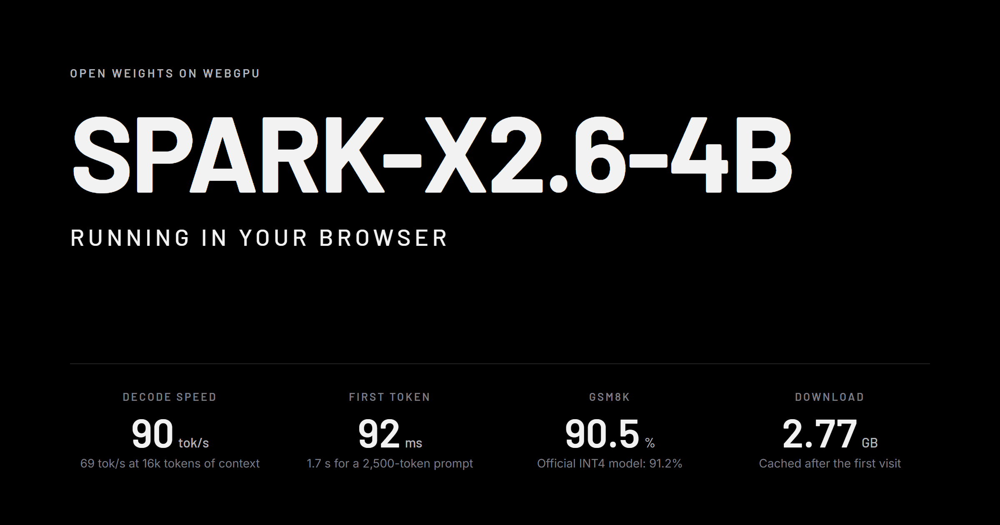
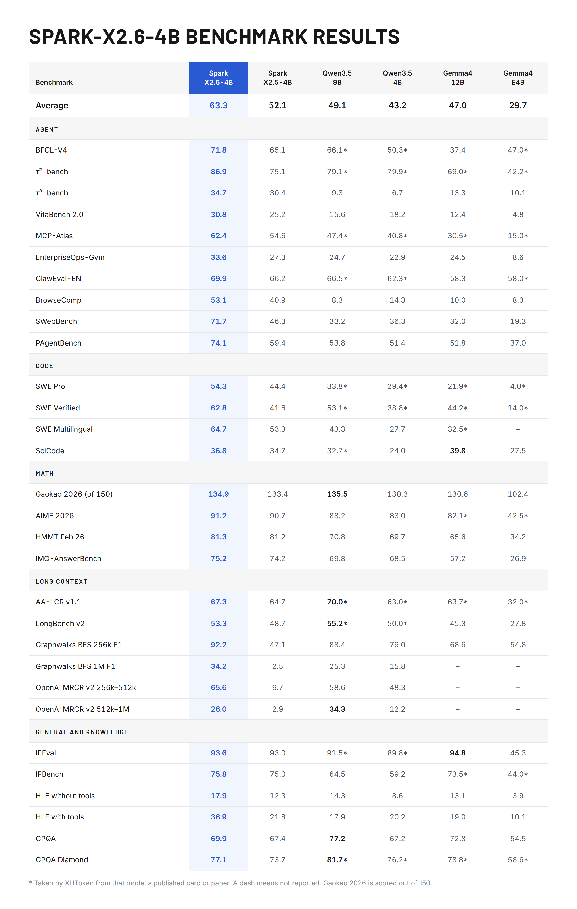
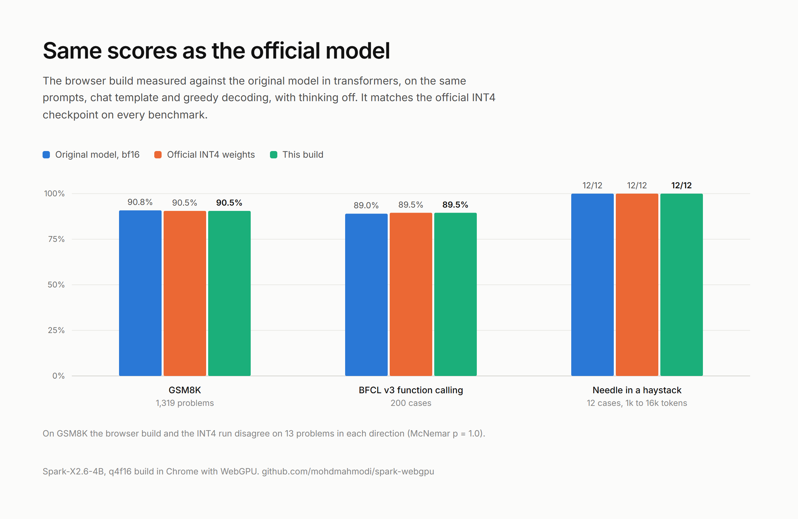
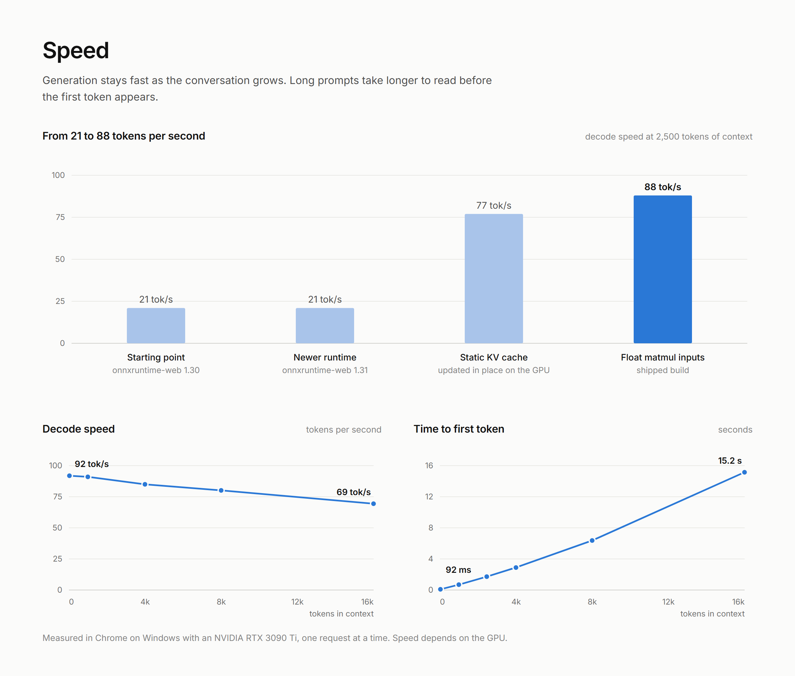

# Spark-X2.6-4B for WebGPU

[](https://huggingface.co/spaces/mohdmahmodi/Spark-X2.6-WebGPU)
[](https://huggingface.co/mohdmahmodi/Spark-X2.6-4B-ONNX-WebGPU)
[](LICENSE)
[](docs/VALIDATION.md)
[](https://onnxruntime.ai/docs/tutorials/web/)
[](#with-transformersjs)



[XHToken/Spark-X2.6-4B](https://huggingface.co/XHToken/Spark-X2.6-4B), the 4-billion-parameter Spark model, converted
to 4-bit ONNX and running entirely in the browser on WebGPU. No server, no install, no data leaves the device.

- [Live demo](https://huggingface.co/spaces/mohdmahmodi/Spark-X2.6-WebGPU)
- [Model files on Hugging Face](https://huggingface.co/mohdmahmodi/Spark-X2.6-4B-ONNX-WebGPU)
- [Validation report](docs/VALIDATION.md)

| Model | Format | Runtime | Status |
|---|---|---|---|
| [Spark-X2.6-4B](https://huggingface.co/mohdmahmodi/Spark-X2.6-4B-ONNX-WebGPU) | ONNX, 4-bit weights (q4f16, q4) | onnxruntime-web, WebGPU | released, validated |

- **Accurate.** No measurable loss against the official INT4 checkpoint in transformers: GSM8K 90.5% (INT4 91.2%,
  bf16 90.8%), BFCL function calling 89.5%, needle in a haystack 12/12. The build adds a mean KL divergence of 0.00055
  on top of the quantization.
- **Fast.** About 90 tokens per second and a first token in under 100 ms on a desktop GPU. The KV cache never leaves the GPU.
- **Complete.** Official chat template, thinking on/off with effort levels, multi-turn with prompt-cache reuse, and
  Spark tool calls.
- **Small.** 2.77 GB download, cached by the browser after the first visit.

## Run it


Open the [live demo](https://huggingface.co/spaces/mohdmahmodi/Spark-X2.6-WebGPU) in desktop Chrome or Edge. To
run the app locally:

```bash
git clone https://github.com/mohdmahmodi/Spark-X2.6-4B-onnx-webgpu && cd Spark-X2.6-4B-onnx-webgpu
```

```bash
npm install
```

```bash
npm run serve
```

Then open http://localhost:8000. Without a local build in `web/spark/`, the page loads the model from the Hugging Face
repository.

| Requirement | |
|---|---|
| Browser | Chrome or Edge 113+ on desktop. GPUs without `shader-f16` get the fp32-activation build automatically |
| GPU memory | about 3.5 GB at 4k tokens of context (2.77 GB weights + 0.6 GB KV cache per 4k tokens) |
| GPU buffer size | `maxBufferSize` of at least 336 MB (the int8 embedding table). The storage-buffer binding limit can be lower: onnxruntime binds larger buffers in pieces, checked down to the 128 MB WebGPU default with the included loader |
| Runtime | WebGPU only in the browser. The WASM (CPU) backend of onnxruntime-web has no kernel for the quantized embedding (`GatherBlockQuantized`), so it cannot load this graph. The same files run with native onnxruntime on CPU (used in the validation). |

URL options: `?model=<url>` loads the model folder from another location, `?variant=q4` forces the fp32-activation
build, `?kv=dynamic` disables the static KV cache.

## Model quality

As reported by XHToken for the original model ([model card](https://huggingface.co/XHToken/Spark-X2.6-4B)), against
models of similar size, with thinking on at high effort. Not re-run here; this build's own checks follow.




## Accuracy of this build

Measured in Chrome on WebGPU against the original model in transformers, on identical prompts, chat template and
greedy decoding. The official INT4 weights run in transformers are the bar to meet, since this build uses those
exact 4-bit codes.



| Check | transformers bf16 | transformers, official INT4 | This build |
|---|---|---|---|
| GSM8K, 1,319 problems, thinking off | 90.8% | 91.2% | 90.5% |
| BFCL v3 simple function calling, 200 cases | 89.0% | 89.5% | 89.5% |
| Needle in a haystack, 1k–16k tokens, 12 cases | 12/12 | 12/12 | 12/12 |
| Next-token KL divergence to bf16, 160 positions | 0 | 0.0236 | 0.0238 |
| Greedy parity, 50 prompts: first token identical | 50/50 | 47/50 | 46/50 |
| Thinking, multi-turn, tool-call round trip | 6/6 | | 8/8 |
| 30-minute soak, 683 generations | | | 0 errors, flat GPU memory |

On GSM8K the browser build solves 9 fewer problems than the INT4 checkpoint (22 and 13 disagreements, McNemar
p = 0.18) and 4 fewer than bf16, which is within noise. The other checks score the same.



Measured in Chrome on Windows 11 with an NVIDIA RTX 3090 Ti, one request at a time. Speed depends on the GPU.

| Context | 28 | 1k | 4k | 8k | 16k |
|---|---|---|---|---|---|
| Decode, tok/s | 92 | 91 | 85 | 80 | 69 |
| Time to first token | 92 ms | 0.69 s | 2.9 s | 6.4 s | 15.2 s |

The [validation report](docs/VALIDATION.md) has per-system tables, the worst divergences side by side, McNemar tests
against the INT4 run and the speed history. The same results as an interactive page:
[`web/benchmarks.html`](web/benchmarks.html).

## How it works

`convert/export_onnx.py` writes the ONNX graph op by op from the safetensors checkpoint, without tracing, using the
fused operators that onnxruntime-web's WebGPU execution provider has kernels for.

| Spark-X2.6-4B | ONNX |
|---|---|
| 36 layers, 3 sliding-window (512) to 1 full attention | `GroupQueryAttention` with `local_window_size` 512 or −1 |
| RoPE θ 10⁴ full rotary (sliding), θ 5×10⁶ partial 64 of 256 dims (full) | GQA `do_rotary`, one cos/sin cache per layer type |
| 16 query heads, 4 KV heads, head dim 256, fused QKV projection | packed QKV input to GQA |
| per-head sigmoid output gate (`g_proj`, 2560 → 16) | 8-bit `MatMulNBits`, `Sigmoid`, `Mul` |
| gated GELU MLP, 2560 → 10240 | 4-bit `MatMulNBits` ×3, `Gelu`, `Mul` |
| RMSNorm with residual | `SimplifiedLayerNormalization`, `SkipSimplifiedLayerNormalization` |
| tied embedding and LM head, vocabulary 131,072 | one int8 tensor shared by `GatherBlockQuantized` and `MatMulNBits` |

Design decisions, each measured before it was kept:

- **Official quantization, repacked losslessly.** The GPTQ codes from
  [Spark-X2.6-4B-INT4](https://huggingface.co/XHToken/Spark-X2.6-4B-INT4) map directly onto `MatMulNBits` (4-bit,
  group size 32). Round-to-nearest 4-bit was tried first and is far less accurate on this model (mean KL 0.50 vs 0.21).
- **One int8 table for the embedding and the LM head.** The official checkpoint keeps a separate bf16 input embedding
  (640 MB). This build looks up input tokens in the int8 LM-head table instead, which saves that download. Measured on
  its own in transformers, the swap costs nothing measurable: mean KL 0.0003 to bf16, GSM8K 1,197 vs 1,198, BFCL 175
  vs 178 (p = 0.25).
- **`accuracy_level=0`.** Level 4 lets WebGPU quantize activations to int8 during prefill. That cost 1.2 GSM8K points
  (89.3% vs 90.5%, p = 0.04). Level 0 is also faster at decode (88 vs 75 tok/s); prefill is about 45% slower.
- **fp16 activations.** fp32-activation and fp32-residual builds score the same within noise; peak hidden-state
  magnitude is about 700, well inside fp16 range.
- **Static KV cache.** One preallocated GPU buffer per layer is bound as both the `past_key_values` input and the
  `present` output, so attention appends in place with no per-token allocation or copy. Decode at 2.5k tokens of
  context went from 21 to 77 tok/s with this change. A follow-up chat turn reuses the cached prefix and only prefills new
  tokens.
- **Last-position logits only.** Prefill never materializes a `[sequence, 131072]` logits tensor.
- **Memory.** Downloaded weight buffers are released after the session is created; the page holds about 30 MB of
  JavaScript heap after loading.
- **onnxruntime-web 1.31 dev build.** 1.30.0 disables flash attention on sliding-window layers past 512 tokens of
  context ([microsoft/onnxruntime#32462](https://github.com/microsoft/onnxruntime/pull/32462)). The app pins the
  build it was validated with; the 1.31.1 release has not been validated here yet.

## Use it in your own page

`web/lib/` holds the reusable part: `spark.js` (model loading, static KV cache, generation), `chat.js` (tokenizer and
chat template) and `toolcall.js` (tool-call parser). They are plain ES modules with no build step:

```js
import { loadSpark } from "./lib/spark.js";

const spark = await loadSpark({
  base: "https://huggingface.co/mohdmahmodi/Spark-X2.6-4B-ONNX-WebGPU/resolve/main",
  onProgress: ({ loaded, total }) => console.log(`${((100 * loaded) / total).toFixed(0)}%`),
});

const messages = [{ role: "user", content: "Explain WebGPU in one sentence." }];
let reply = "";
for await (const piece of spark.generate(messages, { thinking: false, temperature: 0.7, maxNewTokens: 512 })) {
  reply += piece;
}
```

`generate` also accepts `effort` (`"high"` or `"low"`), `tools` (OpenAI-style function definitions),
`topP`, `topK` and `signal` (an `AbortSignal`). `parseToolCalls` from `web/lib/toolcall.js` extracts Spark tool calls
from the output. Add the import map from `web/index.html`, which pins onnxruntime-web, tokenizers.js and jinja.

### With Transformers.js

The published files also load in Transformers.js 4.3. `config.json` declares `model_type: "qwen3"`: Transformers.js
has no class for Spark, and its Qwen3 decoder feeds this graph exactly the inputs and KV cache it expects.

```js
import { pipeline } from "@huggingface/transformers";

const generator = await pipeline("text-generation", "mohdmahmodi/Spark-X2.6-4B-ONNX-WebGPU", { device: "webgpu", dtype: "q4f16" });
const out = await generator([{ role: "user", content: "Explain WebGPU in one sentence." }], {
  max_new_tokens: 256, do_sample: false, tokenizer_encode_kwargs: { enable_thinking: false },
});
console.log(out[0].generated_text.at(-1).content);
```

The answers are the same as the app's: identical logits, and identical output on all 50 greedy prompts, all 200 BFCL
cases, all 1,319 GSM8K problems and all 12 needle tests up to 16k tokens. Transformers.js grows its KV cache at every
step, so decoding slows down as the context grows. Same machine, same run:

| Context | Transformers.js | `web/lib/spark.js` |
|---|---|---|
| short prompt | 86 tok/s | 92 tok/s |
| 1k tokens | 79 tok/s | 91 tok/s |
| 4k tokens | 18 tok/s | 87 tok/s |
| 8k tokens | 13 tok/s | 80 tok/s |
| 16k tokens | 7.8 tok/s | 71 tok/s |

The Transformers.js column uses onnxruntime-web `1.31.0-dev.20260918`, the app's build. 16k-token prompts need that
build or newer: Transformers.js 4.3.2 bundles an older one that fails on them. With the newer build swapped in, all 12
needle tests up to 16k tokens pass with output identical to the app's.

On a GPU with the 128 MiB default storage-buffer binding limit, as on many phones, use the included loader for long
prompts. Transformers.js prefills a prompt in one pass, and onnxruntime-web's layer-norm kernels
return zeros once the hidden state is larger than one binding, without an error: from 13,108 tokens with
`q4` and 26,215 with `q4f16`. The included loader prefills in pieces and is not affected. Reported as
[microsoft/onnxruntime#33755](https://github.com/microsoft/onnxruntime/issues/33755); the fix is [#33760](https://github.com/microsoft/onnxruntime/pull/33760).

## Repository layout

```
web/
  lib/         reusable modules: model loader and generation, tokenizer and chat template, tool-call parser
  app/         chat app, project page, benchmark and test hooks
  assets/      styles, icon sprite, favicon
  index.html   chat app
  benchmarks.html  results, speed, usage
convert/       checkpoint to ONNX export and model-folder assembly
model-card/    Hugging Face model card and its images
tests/         correctness tests and the full validation suite
tools/         local server, benchmark, screenshots, Space builder, icon sprite, downloads
docs/          validation report and hosting guide
```

## Build and validate from source

Python 3.11, Node 20+, Chrome, about 30 GB of disk. The 4-bit export needs about 10 GB of RAM.

```bash
pip install -r requirements.txt
```

```bash
bash tools/download.sh
```

1. **Export.** `python convert/export_onnx.py q4f16` and `python convert/export_onnx.py q4` write `web/spark/onnx/`.
   `python convert/build_web.py` adds the tokenizer, chat template, config, license and model card.
2. **Correctness.** `python tests/reference.py` saves transformers reference outputs. `python tests/test_gqa_op.py`
   checks the attention operator against the reference math, and `python tests/test_onnx.py q4f16` checks the
   exported graph. `python tools/make_tokenizer_cases.py` followed by `npm run check-tokenizer` compares the
   JavaScript tokenizer and chat template with transformers.
3. **Validation.** `bash tests/run_all.sh` runs every suite on transformers, CPU onnxruntime and the real browser
   build, then writes `docs/VALIDATION.md`. It takes about 3 hours on an RTX 3090 Ti.
4. **Speed and images.** `npm run bench` measures load, time to first token and decode speed. `npm run shots`
   regenerates the images in `model-card/assets/`.

Hosting your own copy of the app or model: [docs/HOSTING.md](docs/HOSTING.md).

## Limitations

- Tested on Windows 11, Chrome and an RTX 3090 Ti only. macOS, Android, integrated GPUs and other vendors are untested.
- Benchmarks use thinking off; they are not comparable to results measured with thinking on.
- Two tabs of the app in one Chrome instance can exhaust D3D12 descriptor heaps on Windows ("device lost"). One tab
  per browser works.
- A browser that allows less than 336 MB per GPU buffer (`maxBufferSize`) cannot load the model. Lower limits were
  checked by giving the page a device with reduced limits on the same GPU, not on real low-end hardware.
- Sliding-window layers keep a full-length KV buffer, since the WebGPU attention kernel has no windowed cache. That is
  about 147 KB of GPU memory per token of context.

## Author

Mohd Mahmodi, [GitHub](https://github.com/mohdmahmodi) and [X (@mohdmahmodi)](https://x.com/mohdmahmodi).

## License

Apache-2.0 for the code in this repository, see [LICENSE](LICENSE). Spark-X2.6-4B is released by XHToken under
Apache-2.0; the converted weights carry the same license. Icons: [Lucide](https://lucide.dev) (ISC) and
[Simple Icons](https://simpleicons.org) (CC0).
